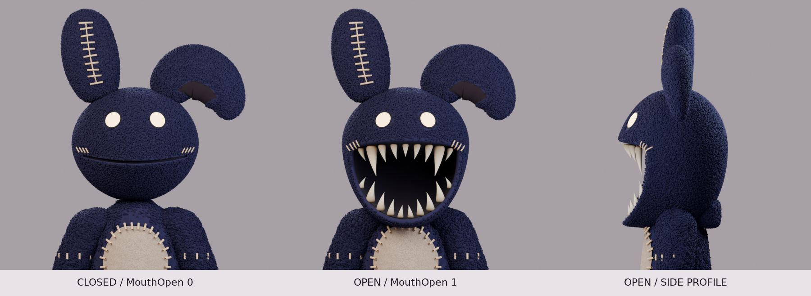

# Plush v19 — Mouth Refinement / Blender 5.3

An editable model revision of the plush rabbit monster, continuing from v18 and using the supplied **open-mouth / side-profile / closed-mouth reference sheet**. This pass concentrates on the face, jaw silhouette, fangs, ears and textile detail. The body is retained from v18 with a softened shoulder/neck transition.



## Open the model

Open **`Plush-v19-Mouth-Refinement.blend` in Blender 5.3.0**. The scene is self-contained: materials and curled fleece are procedural; no external textures or add-ons are required. The small compressed file size is not a proxy or missing-mesh download.

Select **`ARM_Plush_v19` → Object Properties → Custom Properties → `MouthOpen`**:

- `0` — closed upturned smile, with teeth tucked inside the head;
- `0.5` — intermediate opening;
- `1` — dropped chin, deep rounded-U aperture and visible dental arches.

The saved scene opens at `MouthOpen = 1`. The default review camera is `CAM_V19_hero`; `CAM_V19_front`, `CAM_V19_profile` and `CAM_V19_full` provide other views. F12 renders the current camera.

Interactive viewports use 20% of the curled-fleece density to keep editing responsive; actual renders use the full density.

## What changed from v18

- Replaced the facial shell with a continuous quad-majority surface: rounded textile lip, deep lined cavity, stable upper cranium and a lower chin that descends with the mouth.
- Replaced the nearly elliptical gape with a taller U-shaped opening and a flatter upper lip.
- Rebuilt both dental arches. Larger curved side canines contrast with shorter central teeth; the lower teeth follow the jaw curve. The closed state retains space for teeth behind the lips instead of collapsing the cavity onto them.
- Added a deforming inner soft-lip closure to prevent enamel showing through the resting smile.
- Added a coordinated upper-chest compression and small rearward neck movement during opening, so the body no longer pokes into the lower mouth cavity. The closed endpoint and lower torso are preserved.
- Reprojected the glowing eye insets and cheek stitches onto the deformed face; fleece clearance follows the live eye surfaces.
- Replaced the narrow ears with broad padded forms, a drooping folded lobe, dark inner felt and surface-conforming tan stitching.
- Added actual short curled textile instances and a more subdued navy-violet material. The fleece remains separate from the editable deformation mesh.
- Kept the existing 38-bone armature and older locomotion actions. Those actions are historical `LEGACY_` clips, **not newly corrected movement animations**.

## Verification and previews

`QA_SUMMARY.md` explains the numeric checks and their limits. The `qa/` folder contains the machine-readable reports. The `previews/` folder contains genuine Cycles renders of this saved Blender file, not AI-generated concept images.

The workflow uses the **Creature Artist, Retopology, Rigging and Materials** Blender skills from [arjun988/blender-skills](https://github.com/arjun988/blender-skills). Their influence here is silhouette-first construction, explicit facial loops, normalized deformation weights, independent opening-state tests and reusable procedural materials. Neither those skills nor a passing mesh test establish artistic likeness automatically.

## Rebuild and inspect

The `source/` folder includes the untouched v18 input model, the v19 builder, the read-only renderer, the independent mouth auditor and a whole-scene topology/weight inventory. From this directory:

```bash
blender -b -t 4 --python source/refine_plush_v19.py -- --no-render
blender -b -t 4 --python source/render_plush_v19_review.py
blender -b -t 4 --python source/audit_mouth_v19.py -- \
  source/plush_v19/Plush-v19-Mouth-Refinement.blend --dense \
  --output source/plush_v19/audit_mouth_v19_dense.json
blender -b -t 4 --python source/audit_scene_v19.py -- \
  source/plush_v19/Plush-v19-Mouth-Refinement.blend \
  --output source/plush_v19/audit_scene_v19.json
```

Rebuilt outputs go to `source/plush_v19/`, separate from the ready-to-open model at the package root. To audit the delivered file instead, pass `Plush-v19-Mouth-Refinement.blend` as the audit input. Rebuilding may produce different container bytes; the supplied checksum identifies the delivered file, not a promise of byte-identical rebuilding.

The user's original reference image/videos are intentionally not redistributed in this repository. Approximate reference measurements are included as notes, not as calibrated 3D ground truth.

## Remaining work / export boundary

This is a **high-detail model-review master**, not a finished Roblox runtime asset. It still needs an explicitly budgeted game LOD, UVs and baked texture/normal maps, export validation and new movement clips. Exclude `V19_07 • procedural boucle / render master only` and `V19_08 • review studio / exclude from export` from an engine export; convert/bake fleece deliberately rather than exporting all instances.

The closed smile, open silhouette, lining and teeth have received targeted attention. Body proportions, hand/foot deformation and locomotion remain a separate pass; this revision is not claimed to be an exact reconstruction of the illustrated character.
