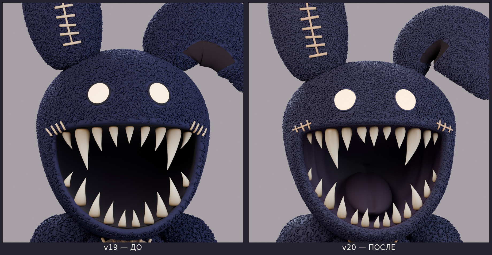
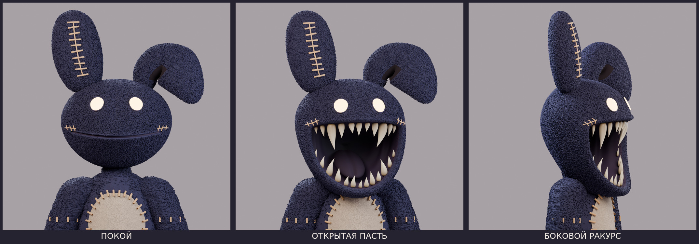

# Plush v20 — Face and Mouth Study / Blender 5.3

A reference-driven revision of the plush rabbit monster's face. The previous v19 corrected the gross opening but still had an inflated upper face, a rear skull that stretched with the jaw, a smooth empty-looking cavity and overly regular teeth. This revision addresses those secondary forms rather than merely adding subdivision.



## Open and control

Open **`Plush-v20-Face-Study.blend` in Blender 5.3.0**. It is an editable, self-contained model with procedural materials and fleece, not a proxy. No external texture files or add-ons are required. The compressed file's small size does not indicate missing geometry.

Select **`ARM_Plush_v20` → Object Properties → Custom Properties → `MouthOpen`**:

- `0` — closed smile, teeth tucked behind the soft lip closure;
- `0.5` — intermediate opening;
- `1` — full gape, the saved default.

F12 renders the current camera. Cameras include `CAM_V20_hero`, `front`, `profile`, `reference_side`, `mouth` and `full`, all with the `CAM_V20_` prefix. The oblique `reference_side` is intentionally different from the nearly exact profile: the reference sheet's side panel also shows part of the far dental arch.

The viewport uses 20% of the render fleece density for responsiveness. Fleece is separate from the deformation mesh and can be hidden while editing.

## Analysis and changes from v19

| Reference mismatch | v20 change |
|---|---|
| Tall, smooth forehead; eyes too far above the upper lip | Lowered the crown and eye level, added broad orbital and cheek padding plus a restrained central cloth-panel seam. Eye size and spacing were largely preserved. |
| Back of head elongates with the jaw | Faded jaw displacement towards the rear skull. The front chin still drops, while the rear underside remains nearly stationary. |
| Thin, rubber-like mouth rim | Added a rounded padded lip cross-section, fuller lower chin and short textile nap on the open roll. |
| Almost empty dark funnel | Added three broad sidewall folds, differentiated plum cloth lining, recessed throat and a volumetric tongue/floor with a central groove and an embedded rear root. |
| Sparse, orderly cone teeth | Rebuilt 11 upper and 13 lower individual crowns, with varied lengths, depths, leans and curved elliptical sections. Added subtle lengthwise enamel variation. |
| Repeated closed-loop fleece and disconnected cheek tacks | Replaced the single loop with three irregular multi-strand tuft variants; connected the cheek repair stitches and softened eye sockets. |
| Broad headphone-like ear bend | Localized the fold and reshaped the hanging distal pillow; reseated both ears on the shorter crown. |
| Neck intrusion at intermediate opening | Added a front-weighted midpoint neck corrective, leaving the endpoints and rear contour undisturbed. |

The body and 38-bone rig remain based on the retained v18/v19 work. Historical `LEGACY_` locomotion clips are still present, **not newly retargeted or approved**.

### Measured form changes

These numbers describe model geometry, not a reference-similarity score. Ears and cosmetic fleece are excluded from head dimensions. Full definitions and both input hashes are in `qa/face_metrics_comparison.json`.

| Open-face measurement | v19 | v20 |
|---|---:|---:|
| Crown → upper lip / head width | 0.43411 | 0.36608 |
| Eye center → upper lip / head width | 0.18277 | 0.14540 |
| Aperture width × height, scene units | 1.31783 × 0.98743 | 1.31716 × 0.98744 |
| Rear skull underside change during opening, fixed probe | −0.29646 | −0.00772 |

The upper face is more compact while the actual mouth opening is essentially the same size. The approximate ratios estimated from the illustrated references are guides, not calibrated 3D truth.

## Verification and actual renders



`QA_SUMMARY.md` separates structural checks from artistic review. The delivered bytes were reopened in Blender 5.3.0 and checked at **41 mouth positions**, including intermediate states. The reports are read-only and include input checksums.

`previews/` contains actual Cycles renders, not AI-generated replacement artwork. The v19/v20 comparison uses the same camera, scale, lights, samples and color management, with compositing bypassed equally. Normal v20 review renders retain the model's restrained eye-glow compositor. Original user reference images and videos are not redistributed.

The **Creature Artist, Retopology, Materials and Rigging** skills from [arjun988/blender-skills](https://github.com/arjun988/blender-skills) informed this pass: secondary forms before surface noise, deliberate facial loops, deformable topology, reusable procedural materials, normalized weights and intermediate-state checks. They do not substitute for evaluating the visible likeness.

## Rebuild and rerun checks

From this package directory, using the Blender 5.3.0 executable in place of `blender` if it is not on PATH:

```bash
# Rebuild into source/plush_v20/; the delivered root file is never overwritten.
blender -b -t 4 --python source/refine_plush_v20.py -- --no-render

# Render the delivered model directly, or omit --blend to render the rebuild.
blender -b -t 4 --python source/render_plush_v20_review.py -- \
  --blend Plush-v20-Face-Study.blend --output-dir review_renders

# Read-only checks on the delivered file.
blender -b -t 4 --python source/audit_mouth_v20.py -- \
  Plush-v20-Face-Study.blend --dense --output review_mouth_qa.json
blender -b -t 4 --python source/audit_scene_v20.py -- \
  Plush-v20-Face-Study.blend --output review_scene_qa.json

# These comparisons also need v19, retained in the adjacent PR asset directory.
blender -b -t 2 --python source/compare_face_metrics.py -- \
  --v19 ../plush_v19_mouth_refinement/Plush-v19-Mouth-Refinement.blend \
  --v20 Plush-v20-Face-Study.blend --output review_metrics.json
blender -b -t 4 --python source/render_v19_v20_comparison.py -- \
  --v19 ../plush_v19_mouth_refinement/Plush-v19-Mouth-Refinement.blend \
  --v20 Plush-v20-Face-Study.blend --output-dir comparison_renders
```

The builder includes its exact, untouched v18 input alongside the script. Its SHA-256 is `89c3557a719bbc433ca2e6c87724513bc73d51c392b34be9a932201730b34483`. Only Blender-bundled Python modules are needed. This pass uses the Blender 5.3 compositor API; earlier-version compatibility is not claimed. Rebuilding may produce different container bytes; `SHA256SUMS.txt` identifies the delivered artifacts, not byte-identical regeneration.

## Honest remaining differences / export boundary

This is an improved **art-review master**, not a completed likeness or Roblox runtime export. The reference still has softer, less uniform lip and face contours, more integrated warm eye glow, more varied textile layering and a less orderly dental rhythm. The new folds and tongue provide structure, but the lining is not an exact reconstruction of the reference.

The scene contains procedural fleece and review lights/cameras; it still needs a budgeted game LOD, UVs, baked textures/normals, export checks and new movement work. Exclude `V20_07 • procedural boucle / render master only` and `V20_08 • review studio / exclude from export` from a runtime export unless deliberately converted/baked. Do not export all fleece instances as a Roblox character.

The facial core meshes are manifold in the audit. Inherited decorative overlays elsewhere retain open boundaries and coincident belly-inlay center edges, explicitly recorded in the scene report. The whole scene is **not** claimed to be watertight or collision-free in every pose.
