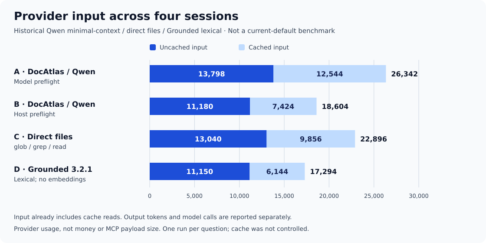
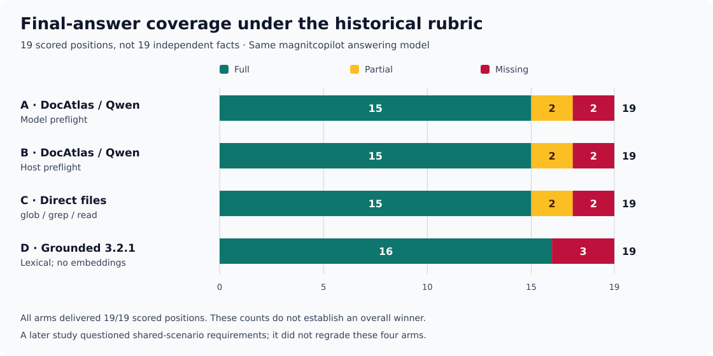

# Historical comparison: DocAtlas, direct files, and Grounded

This page explains the README charts. It is a **small diagnostic, not a benchmark
of the current default or a release acceptance gate**. The documentation audit
on 2026-11-13 recomputed published session totals and checked their source hashes;
it did not run new retrieval, Qwen, or answering-model sessions.

## What was measured

Four fixed Meridian questions were answered through four client paths. Each
question/path pair ran once: **16 sessions** in total. The permitted corpus was
the same **six English documents**; two questions were in Russian and two in
English. All paths used the same **magnitcopilot** answering profile. Historical
provider identifiers and filenames remain unchanged in the evidence.

| Arm | Documentation path | Language preflight |
| --- | --- | --- |
| A | DocAtlas, experimental Qwen minimal-context | Model calls `docs_status` |
| B | Same historical DocAtlas/Qwen profile | Host performs `host-v1` preflight |
| C | Direct `glob` / `grep` / `read` | No DocAtlas host preflight |
| D | Grounded, `@arabold/docs-mcp-server` 3.2.1 | No `host-v1` hint |

DocAtlas A/B used code `220d2dab`, **Qwen3-Reranker-0.6B**, the
`qwen3-contextual-own-body-evidence-v1` recipe, `one-hop-v1`, and `concise-v1`.
These are **not** today's lexical default, the later paired-Qwen profile, or
STEP17 `no_redundancy`. Grounded was run in **lexical mode with zero indexed
embeddings**. Grounded is an MCP server, not the direct-file baseline C.

This compares complete client paths, including tool schemas, preflight,
continuations, and provider history. It does not isolate reranker quality.

## Provider usage

Totals below include all provider calls in the four reported sessions per arm,
including the no-answer question. They are **provider token usage**, not the
size of a single MCP response or the cost of building an index.



| Arm | Input including cache | Cache read | Uncached input | Output including reasoning | Model calls |
| --- | ---: | ---: | ---: | ---: | ---: |
| A — DocAtlas/Qwen, model preflight | 26,342 | 12,544 | 13,798 | 1,245 | 13 |
| B — DocAtlas/Qwen, host preflight | 18,604 | 7,424 | 11,180 | 1,150 | 9 |
| C — Direct files | 22,896 | 9,856 | 13,040 | 1,727 | 14 |
| D — Grounded lexical | 17,294 | 6,144 | 11,150 | 1,434 | 10 |

`uncached = input - cache_read`: do not add cache reads to input again.
Reasoning is already inside output and must not be added again. Cache writes
were zero. No monetary-cost comparison is established: applicable tariffs,
local inference/indexing costs, and controlled caching are not supplied here.
Preparation calls and orchestration-agent usage are outside these totals.

Host-preflight DocAtlas and Grounded differ by **30 uncached input tokens**
(11,180 versus 11,150). That is a descriptive near-tie in this run, not a
statistical equivalence test or evidence that one system is cheaper.

## Delivery and final answers are different measurements

The historical rubric scores 8 + 6 + 5 = **19 positions** across three questions.
Weather facts repeat between questions, so these are not 19 independent facts.
The fourth question tests abstention when the permitted corpus contains no
mandatory cooling temperature; it is outside the 19-position denominator.



| Arm | Delivered to answering model | Full | Partial | Missing | Contradicted |
| --- | ---: | ---: | ---: | ---: | ---: |
| A — DocAtlas/Qwen, model preflight | 19/19 | 15 | 2 | 2 | 0 |
| B — DocAtlas/Qwen, host preflight | 19/19 | 15 | 2 | 2 | 0 |
| C — Direct files | 19/19 | 15 | 2 | 2 | 0 |
| D — Grounded lexical | 19/19 | 16 | 0 | 3 | 0 |

The rubric accepts faithful paraphrases; it is not a literal-string accuracy
score. Full means all required parts of a scored position are expressed;
partial means a qualification is absent; missing means the position is not
expressed. Contradictions are reported separately, not silently treated as full.
No arm invented a cooling temperature on the fourth question. The STEP14 report
notes a weaker absence claim in the direct-file arm; absence in a search result
is not proof that the entire documentation contains no such requirement.

All 19 scored positions were delivered in every arm. Under the original rubric,
some were still only partially expressed or absent from the final answer.
Grounded has one more full position than B **and one more missing position**;
there is no predeclared utility function that turns this into an overall winner.

**Rubric limitation:** the later
[question-conditions review](../../eval/blind_project_context/step16-question-conditions/REPORT_RU.md)
questioned the requiredness of some conditions in the shared V-M1 scenario. Its
rubric is a **draft, not owner-approved gold**, and that separate study did not
regrade these four arms. In particular, an instruction to
start a suspension need not be repeated when the question already assumes it;
identifier preservation during suspension remained separately disputed. These
charts preserve the published historical grades instead of silently rescoring
one arm. They are not a universal answer-accuracy ranking.

## Limits on interpretation

- One small corpus and one run per question/path do not establish general quality.
- A/B/C are historical STEP14 sessions; D was added later in STEP15. Run order
  was not randomized and provider caching/load was not controlled.
- Host preprocessing differs. B's language hint was not given to D.
- Complete B/V-M4 end-to-end time is missing after a coordinator timeout,
  although provider outputs and usage were retained. The available B duration
  must not be compared to four-session totals. **No latency chart is published.**
- The Grounded runtime reported a different MCP `serverInfo` version from its
  installed package; `runtime-evidence.json` preserves both. The 3.2.1 label here
  denotes the installed package, not an inferred server version.
- This lexical Grounded result does not qualify its embedding/hybrid modes.
- STEP8, the later STEP16 answer-condition study, and STEP17 `no_redundancy`
  differ in corpus, question set, rubric, or measured stage. They are not pooled
  into these charts.
- The delivery claim relies on the published source-to-provider audits. This
  documentation update rechecked compact session/review artifacts and hashes,
  not every byte of the large historical provider traces.

The useful result is a diagnostic boundary: **delivering source evidence is not
the same as preserving every condition in an answer**. It does not identify
compact/adaptive formatting as the cause, select a new default, or certify release.

## Sources and reproduction

The source snapshot is
[`39d893b4d8886b8bbaa446ba1414271a93604b3b`](https://github.com/Vanilla1999/DocAtlas/tree/39d893b4d8886b8bbaa446ba1414271a93604b3b).
This is the evidence snapshot, not the historical code executed by A/B.

- [STEP14 protocol, profile, and limitations](../../eval/blind_project_context/step14-host-language-live/RESULTS_RU.md)
- [Frozen questions](../../eval/blind_project_context/step14-host-language-live/tasks.json) and [answer rubric](../../eval/blind_project_context/step14-host-language-live/review-criteria.json)
- [Historical A/B/C sessions](../../eval/blind_project_context/step14-host-language-live/results.json)
- [STEP15 report](../../eval/blind_project_context/step15-grounded-live/RESULTS_RU.md) and [usage aggregate with measurement gaps](../../eval/blind_project_context/step15-grounded-live/preliminary-results.json)
- [Grounded sessions](../../eval/blind_project_context/step15-grounded-live/attempt-02/live-02/results.json), [semantic review](../../eval/blind_project_context/step15-grounded-live/semantic-review.json), and [runtime evidence](../../eval/blind_project_context/step15-grounded-live/runtime-evidence.json)
- [Published source-to-provider audit](../../eval/blind_project_context/step15-grounded-live/scope-source-model-audit.json)
- [Generated compact data, per-question metrics, and seven source SHA-256 hashes](../../readme-assets/benchmarks/grounded-meridian.json)

From a repository checkout, using Python 3.11 or newer and only its standard library:

```bash
python scripts/render_readme_benchmarks.py --check
```

This verifies all seven input hashes, the 16 question/arm pairs, session sums,
published usage aggregates, the review's task/rubric bindings, and the generated
JSON/SVG bytes. It makes no network calls and runs no models. Omit `--check` to
regenerate the three small artifacts from those same frozen inputs. A hash
mismatch is a stop condition, not permission to replace the protocol or grades.
