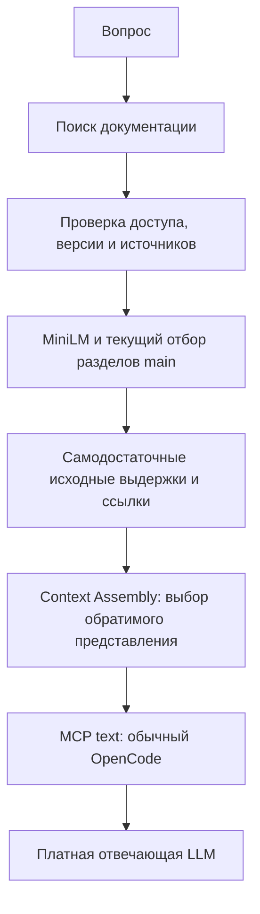

# Context Assembly — отдельный этап перед отвечающей моделью



Context Assembly не является моделью, отбором источников или проверкой
достаточности. Это отдельный модуль `context_assembly.py` после формирования
`standalone_text_view`. Приёмка исходных документов, MiniLM, лимиты main и
сам текст доказательств остаются прежними. Дополнительных LLM-вызовов нет.

## Пять режимов

`DOCATLAS_CONTEXT_ASSEMBLY=literal|grouped|table|grouped-table|adaptive`.

- **literal** — прежний объект JSON; текущий default и откат.
- **grouped** — путь и раздел объявлены в `source_groups` один раз; каждая
  исходная запись хранит свой индекс группы и все остальные поля.
- **table** — названия полей объявлены в `source_columns` один раз, значения
  остаются в строках. Разнородные записи не приводятся к null: остаётся literal.
- **grouped-table** — таблица со справочником одинаковых путей/разделов.
- **adaptive** — сравнение полных текстов, включая инструкции чтения,
  токенизатором o200k; выбор самого короткого допустимого представления.
  При равенстве выигрывает literal, затем grouped, table, grouped-table.

В группе объединяется только представление path/section, не доказательства:
не меняются число и порядок записей, точные тексты, ref, source_uri, координаты,
scope/version/authority/trust. Все сведения остаются в MCP text, без приватной
`_meta`. Ошибки, запреты, пустой контекст и неподдерживаемые формы не упаковываются.
Восстановление каждого кандидата сравнивается с исходным JSON побайтово после
канонической сериализации; разные типы и отсутствие поля не считаются равными.
`decode_context` восстанавливает модельное представление, НЕ полный внутренний
машинный пакет и НЕ разрешение читать произвольные источники.

Новый лимит 3000 токенов не вводится. Унаследованная граница 12000 полного пакета
не меняется; кандидат упаковки не должен нарушить её. Ничего не отбрасывается
ради размера: при неподходящем формате используется literal.

## Границы выбора лучшего варианта

Для фиксированного текста adaptive по построению не длиннее literal в o200k.
Это не доказывает лучшего понимания таблиц отвечающей моделью и не гарантирует
тот же выигрыш для другого токенизатора. До платного A/B новый режим не меняет
default main. Пример явного экспериментального включения в окружении MCP:

```text
DOCATLAS_MCP_TEXT_FALLBACK=1
DOCATLAS_MCP_COMPACT_TEXT=1
DOCATLAS_CONTEXT_ASSEMBLY=adaptive
```

## Эксперимент

20 новых вопросов по пяти замороженным реальным корпусам: Black, Poetry,
Vite, ESLint, Textual. Это новые вопросы того же автора, не независимый слепой
benchmark. Среди них русский язык, отрицания, команды, составные условия и
два вопроса с неподтверждённой численной частью. Эталоны — 45 буквальных требований
из исходных файлов; проверяются только после выдачи. В product и в индекс
эталоны не передаются. Успех 0/0 не используется.

Пять режимов вызываются через установленный публичный stdio MCP. Вся цепочка
Python/SQLite/MiniLM ограничивается общим cgroup 1 500 000 000 байт, без swap,
2 CPU; сборка и скачивание весов происходят отдельно. Проверяются исходные
строки, сохранность базы/файлов и отсутствие новых потерь к literal. Дополнительно
повторно обрабатываются 58 записанных MCP-ответов предыдущего эксперимента.

Токены представления считаются на ОДНИХ И ТЕХ ЖЕ идентификаторах источников,
чтобы случайные URI разных серверных процессов не создавали мнимую экономию.
Время MCP и добавленное время сборки измеряются отдельно. Ошибки не считаются
экономией. Платный probe требует явных OPENAI_API_KEY и DOCATLAS_STRONG_MODEL;
без них usage остаётся null и качество ответов NOT_TESTED. Даже оплаченный
однопроходный probe не является полным автономным диалогом OpenCode.

Связанный предыдущий контракт: [OpenCode compact text](./opencode-compact-text.md).
