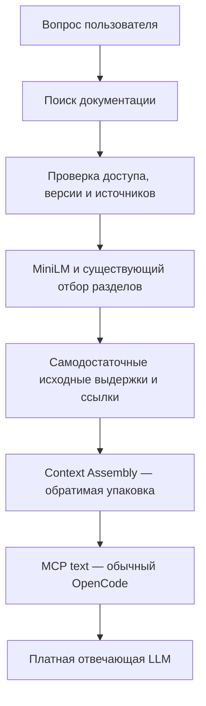

# PR #236 — Context Assembly: результаты и выбор варианта

## Решение

Выбран **adaptive** как лучший из реализованных вариантов по объёму
модельно-видимого контекста при точном сохранении входных данных этапа.
На 20 новых вопросах: **24 644 → 22 382 o200k-токена, −9,18%**.
На прежних 58 записанных ответах (57 успешных): **62 560 → 56 579, −9,56%**.
Это дополнительное сокращение относительно компактного main после PR #235.

Новая сборка не добавляет LLM и не меняет MiniLM, отбор, права или исходные
выдержки. Платная отвечающая модель ещё не испытана: `BLOCKED_NOT_CONFIGURED`,
вызовов 0, provider usage null. Поэтому выбор относится к объёму текста и
обратимости, а не к качеству ответа, счёту провайдера или полному диалогу OpenCode.
PR остаётся Draft, literal остаётся default. Main не изменён.

База: `53590d7db23839c62fa00a833382be56fb6c6954`.
Испытанный продукт: `2ec7c63cf6dc39e2f551a505451216231195995f`.
Завершённый аудит с исправленной проверкой: `e9d69bdf1b59c66de490d6c0c76ac8d90a8202cd`.
После измерения не менялись продукт, вопросы, эталоны, исходные документы,
модель MiniLM или инструкции платного probe.

## Отдельный этап на схеме

Это отдельный `docmancer/docs/application/context_assembly.py`, вызываемый из
`standalone_text_view.py` после формирования источников. Контракт и описание
режимов: [Context Assembly](../../docs/context-assembly.md).

## Реализованы все четыре представления и адаптивный выбор

| Режим | Что меняется | Новые 20: токены | Прежние 58: токены | Вместе, 77 успешных |
|---|---|---:|---:|---:|
| literal | Прежние JSON-объекты | 24 644 | 62 560 | 87 204 |
| grouped | Общие путь/раздел объявлены один раз | 24 014 | 61 573 | 85 587 |
| table | Имена колонок объявлены один раз | 23 154 | 58 614 | 81 768 |
| grouped-table | Таблица и справочник путей/разделов | 22 560 | 57 689 | 80 249 |
| **adaptive** | Самый короткий допустимый полный текст | **22 382** | **56 579** | **78 961** |

Вместе выигрыш 9,45%. В число токенов входят пояснения к чтению колонок и групп.
Каждое сравнение использует ОДИН исходный ответ с одинаковыми evidence ID и URI.
Фактические тексты отдельных серверных запусков тоже сохранены и пересчитаны;
их случайные ссылки дают небольшие различия, которые не выдаются за эффект
упаковки. Например, реальные суммы literal/adaptive новых запусков составляют
24 644/22 333, но честный изолированный эффект формата — 24 644/22 382.

Новые 20: adaptive выбрал grouped-table 12 раз, table 5, literal 3.
Прежние успешные 57: grouped-table 29, table 18, literal 10. Grouped отдельно
ни разу не был минимальным, хотя реализован и проверен как отдельный режим.

Примеры новых вопросов на одинаковых ссылках:

| Случай | До | После | Выбор |
|---|---:|---:|---|
| A20-03: Black required-version, major/configuration | 1 835 | 1 585 | grouped-table |
| A20-09: Vite HTML env и отсутствующие переменные | 2 720 | 2 303 | grouped-table |
| A20-13: стратегия кеша ESLint | 445 | 445 | literal |
| A20-16: подавление предупреждения ignored | 324 | 324 | literal |

Для A20-16 принудительный grouped-table занимает 366 токенов против 324.
Поэтому фиксированная «таблица всегда» — не лучший вариант. Adaptive не меняет
формат ради самого изменения.

## Почему выбор не зависит от ещё одной эвристики релевантности

Для каждого допустимого кандидата проверяется точное обратное восстановление
канонического входного JSON, включая типы, порядок и отсутствие полей. Literal
всегда остаётся кандидатом. Adaptive выбирает минимум по полному o200k-тексту.
Следовательно, для одинакового входа его результат не длиннее literal в этом
токенизаторе. Это минимум среди четырёх реализованных форм, НЕ глобально
минимальный достаточный контекст и НЕ гарантия меньшего счёта другого провайдера.

Нет удаления предложений, обрезания чисел, пересказа, новых source capabilities
или приватной зависимости от `_meta`. Тексты, пробелы, порядок каждой входной
выдачи, ID, URI, координаты и доверие восстанавливаются точно. Разнородные строки
не дополняются null вместо отсутствовавших полей. Неподдерживаемые формы,
непригодные кандидаты и ошибки оставляют прежнее представление. Сохранены
старые ограничения полного пакета; новый лимит 3000 токенов не вводился.

## Проверка новыми вопросами и достаточность

Добавлены 20 новых вопросов: по четыре для Black, Poetry, Vite, ESLint и Textual.
Есть русский язык, отрицания, команды, составные условия, зависимости и
исключения. Вопросы не совпадают дословно с предыдущими 58. Они написаны тем же
автором поверх прежних замороженных реальных корпусов: это НЕ независимый слепой
benchmark и НЕ новые невиденные репозитории.

До запуска зафиксированы 45 буквальных требований из исходных файлов. SHA-256
файла вопросов: `a814ebdb5efd0a2fb781d9c0376586150fac9dbf02fbb8011ac929ee89c6dc96`.
Gold не передавался селектору или в индекс и не менялся после результатов.

**Во всех пяти режимах сохранено одинаково 43/45 требований; новых потерь нет.**
Все размеченные документированные части присутствуют в 19/20 случаев.
Два требования отсутствуют в A20-06 во всех режимах уже до упаковки:
русский вопрос о `virtualenvs.create=false` и уже активированном окружении.
Main отдаёт соседние настройки `virtualenvs.in-project` и локальную настройку,
но не нужный раздел `virtualenvs.create`. Просмотрено не только совпадение строк,
но и полные реально переданные фрагменты: эквивалентного правила там нет.
Упаковка этот пробел не создаёт и не исправляет.

A20-08 и A20-20 дополнительно спрашивают недокументированную численную гарантию.
Проверены сохранённые известные части, но правильность ответов unknown НЕ
проверена без отвечающей модели. 19/20 не является долей правильных финальных
ответов на все части вопросов.

## Время и память

Полный живой runtime в одном cgroup: Python-драйвер, подготовка, SQLite,
MCP-процессы и MiniLM. Лимит 1 500 000 000 байт (ядро округлило до 1 499 996 160),
swap 0, два CPU, сеть выключена. Модель/образ скачивались и строились до runtime.
Пик **552 325 120 байт ≈ 552 МБ**, событий OOM/oom_kill 0. Это пик всего тестового
стека, не «память одного упаковщика» и не обещание для любого корпуса/конкурентности.

Для сборки отдельно выполнено пять локальных повторов на каждом уже полученном
контексте; по каждому взята медиана. Медиана этих 20 значений adaptive —
**4,604 мс**, максимум — **9,450 мс**. Это время сериализации и выбора формата,
не время ответа модели. Результат получен в отдельной проверке на двух CPU.

Медиана настоящего MCP-запроса: literal **9,309 с**, adaptive **9,445 с**.
Запуски последовательные, с отдельными серверными процессами; первые запросы
включают загрузку MiniLM. Разница 0,136 с не является изолированной причинной
оценкой упаковки и не доказывает ускорение/замедление полного платного диалога.
Основное время по-прежнему уходит на прежнюю подготовку и отбор.

## Воспроизводимость, сохранённый сбой и аудит

[Живой запуск 40773895590](https://github.com/Vanilla1999/DocAtlas/actions/runs/40773895590)
выполнил ВСЕ 100 исходных запросов (20 × 5) и пять проверок отсутствующего scope.
Все 100 вернули данные без tool errors; все 25 подготовленных проектов сохранили
исходные файлы и логическое состояние SQLite. Затем завершающий измеритель упал:
он ошибочно требовал одинакового порядка выдач от разных серверных процессов.

В A20-14 grouped-table порядок двух исходных фрагментов уже отличался ДО
сборки. Состав и значения были одинаковы. Исправление НЕ разрешает упаковщику
менять порядок: для каждого из 100 ответов теперь сверяется точное следование
его собственному входному `selected_evidence_ids`. Между независимыми запусками
сравниваются мультимножества, а обнаруженная перестановка явно записана.
Дополнительно для всех форм используется один фиксированный исходный ответ:
его обратное восстановление обязано сохранить весь JSON и порядок побайтово.

[Завершённая проверка 40777452035](https://github.com/Vanilla1999/DocAtlas/actions/runs/40777452035)
прошла успешно на том же продукте. Она переиспользует исходные подписанные
артефакты и настоящие времена из первоначального лога; повторной генерации,
retrieval и подгонки эталонов не было. Один промежуточный audit-run остановился
на запрете gh выводить ANSI-последовательности лога; разрешена только запись
исходного лога в файл. Первый неуспех и его driver_exit=1 не скрыты.

Два основных ZIP сверены с SHA-256 GitHub:

- runtime: `4f80c9b00892442b237c6bb180f9261ea76c4ee3b41242451a11388da87fdc79`;
- audit: `bdae367e4c76840c07c5141a7fb7ce3e1b519a58c5ab76149971be0dde60dd68`.

Внешний офлайн-аудит без импорта DocAtlas отдельно декодировал 100 живых ответов
(690 исходных записей), сверил их с исходными файлами/строками, пересчитал gold и
токены независимым BPE, проверил 100 фиксированных новых представлений и 285
представлений прежних 57 успешных ответов (373 исходные записи). Проверены
неизменённые идентификаторы/URI/метаданные при круговом восстановлении, собственный
порядок, пять недоступных scope и cgroup. Проверки SQLite исполнял живой CI;
офлайн-аудит только сверяет опубликованные подтверждения и не выдаётся за
повторное выполнение базы или inference. Общий CI репозитория не объявляется
полностью зелёным.

Текущий workflow является завершающим аудитом сохранённого runtime. Для нового
полного живого запуска используется исходный workflow коммита `2ec7c63` с
исправленным измерителем `run.py`; сохранённые артефакты имеют срок хранения.

## Платная модель и включение

Адаптер парного сравнения literal/adaptive реализован, но оба запуска получили
`BLOCKED_NOT_CONFIGURED`: не заданы `OPENAI_API_KEY` и `DOCATLAS_STRONG_MODEL`.
**0 платных вызовов, usage=null — это отсутствие измерения, не экономия.**
Входные/выходные/кешированные токены провайдера, качество ответа, корректные
unknown и полное время автономного OpenCode остаются NOT_TESTED. Более короткая
таблица может оказаться менее удобна модели; обратимость Python этого не исключает.

Поэтому adaptive выбран кандидатом и доступен через
`DOCATLAS_CONTEXT_ASSEMBLY=adaptive`, но literal остаётся default. Для перевода
по умолчанию нужен реальный парный A/B отвечающей модели без ухудшения ответов и
ссылок. Дополнительная обученная модель для этого этапа не требуется.
